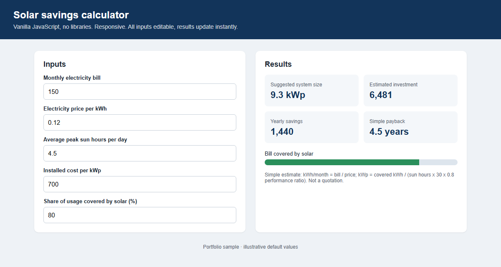

# Solar savings calculator

A small web page that gives a first estimate for a rooftop solar system from a monthly electricity bill: suggested size in kWp, investment, yearly savings and simple payback.

Plain HTML, CSS and JavaScript. No build step, no libraries.

**Live demo:** https://doanh03.github.io/solar-tools/



## How it works

```
kWh per month   = bill / price per kWh
kWh covered     = kWh per month x share covered by solar
system size kWp = kWh covered / (peak sun hours x 30 days x 0.8 performance ratio)
investment      = kWp x installed cost per kWp
yearly savings  = bill x share covered x 12
payback         = investment / yearly savings
```

This is a rough sizing tool for a first conversation with a customer, not a quotation. A real design still needs the roof layout, shading, the inverter datasheet and the local tariff.

## Files

- `index.html`: the page
- `calc.js`: the calculation as a pure function, used by the page and by the tests
- `calc.test.js`: tests, run with `node calc.test.js`

## Embedding

Copy `index.html` and `calc.js` into any site, or load the page in an iframe. It works in WordPress (Custom HTML block) and in Laravel Blade views without changes.

## License

MIT
